<p align="center">
  
</p>

<p align="center">
  <strong>Fast, focused filesystem utilities for Node.js.</strong><br>
  Iterative traversal, glob-aware search, and cross-platform path helpers — with no runtime dependencies.
</p>

<p align="center">
  <a href="https://github.com/optiprune/utils/actions/workflows/tests.yml"></a>
  <a href="https://www.npmjs.com/package/@optiprune/glob"></a>
  <a href="https://www.npmjs.com/package/@optiprune/pathx"></a>
  <a href="LICENSE"></a>
</p>

## Packages

| Package | Purpose |
| --- | --- |
| [`@optiprune/glob`](packages/glob) | Async and sync filesystem crawler with fast glob matching, bounded concurrency, and backpressure. |
| [`@optiprune/pathx`](packages/pathx) | Small, dependency-free path primitives for `/` and `\` separators. |

## Quick start

```sh
pnpm add @optiprune/glob
```

```js
import { glob } from '@optiprune/glob';

const files = await glob(['**/*.{js,ts}', '!**/*.d.ts'], {
  cwd: 'src',
  ignore: ['**/node_modules/**'],
  absolute: true,
});

console.log(files);
```

For streaming or full control:

```js
import { crawl, crawlSync } from '@optiprune/glob';

for await (const path of crawl('src', {
  filesOnly: true,
  includeHidden: false,
  maxDepth: 10,
  filter: path => path.endsWith('.js'),
})) {
  console.log(path);
}

for (const path of crawlSync('src', { filesOnly: true, absolute: false })) {
  console.log(path);
}
```

## Why OptiPrune?

- **No runtime dependencies** — built on Node.js filesystem APIs.
- **Iterative and deep-tree safe** — uses an explicit stack instead of recursion.
- **Resource-conscious** — `Dirent`s avoid unnecessary `stat` calls; `crawlAll` bounds active directory reads.
- **Safe defaults** — symlinks are not followed unless explicitly enabled.
- **Glob matching included** — `**`, `*`, `?`, braces, character classes, negation, and `ignore`.
- **Cross-platform** — `@optiprune/pathx` normalizes Windows and POSIX separators to `/`.

## API overview

`glob` is the default export and an alias of `crawlAll`. The original `crawl`, `crawlAll`, and `crawlSync` APIs remain available. `globSync` provides a synchronous compatibility alias over `crawlSync`. Supported options include `filesOnly`, `dirsOnly`, `includeHidden`, `followSymlinks`, `maxDepth`, `absolute`, `signal`, `filter`, and `onError` (`throw`, `ignore`, or a callback).

```js
import { normalize, isAbsolute, join, resolve } from '@optiprune/pathx';

normalize('src\\lib\\..\\index.js'); // 'src/index.js'
join('src', 'lib', 'file.js');        // 'src/lib/file.js'
```

## Benchmark

Reproducible comparison with `pnpm bench:compare` on a temporary fixture containing 50 nested directories and 10,000 files (`**/*.{js,ts,json}`, 5 measured iterations plus one warm-up). All engines returned 10,000 correct matches with the same digest.

| Engine | Average time | Average RAM | Peak RAM |
| --- | ---: | ---: | ---: |
| **@optiprune/glob** | **11.106 ms** | **67.52 MB** | **73.74 MB** |
| tinyglobby 0.2.17 | 14.506 ms | 69.85 MB | 76.54 MB |
| fast-glob 3.3.3 | 39.790 ms | 81.30 MB | 107.39 MB |
| node:glob (Node 22.13.0) | 57.551 ms | 93.58 MB | 118.89 MB |

**Test environment:** Node.js 22.13.0, Linux 6.18.38+, x64, Intel Xeon 2.50 GHz (6 cores), 7.85 GB RAM. This is a single run on a shared environment; the values are directional and are not a universal performance guarantee.

```sh
pnpm install --frozen-lockfile
pnpm test
ITERATIONS=5 pnpm bench:compare
```

## Development

```sh
pnpm install
pnpm test
pnpm run fmt
pnpm bench
```

Pull requests are welcome. Please add regression tests for new traversal or matching cases and document public API changes in the relevant package README.

## License

OptiPrune Utils is released under the [MIT License](LICENSE). Each package also includes its own copy of the license file for npm consumers.
